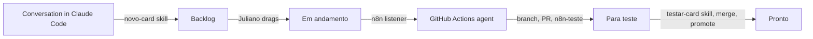

# Kanban: from a conversation to a pull request

How changes to Zacretário are made: a Trello board, a Claude agent on GitHub Actions, and a test copy of n8n. The full design is in [superpowers/specs/2026-11-28-kanban-trello-design.md](superpowers/specs/2026-11-28-kanban-trello-design.md).

## The board

| List | Who puts a card there | What happens |
|---|---|---|
| **Backlog** | Claude, at the end of a brainstorm in Claude Code | The card waits |
| **Em andamento** | Juliano | The agent picks it up and implements it |
| **Para teste** | The agent, when it is done | The card waits for testing, with no deadline |
| **Pronto** | Juliano, or Claude after his "ok" | Done |

Labels: **Bloqueado** (the agent stopped and says why in a comment) and **Na fila** (waiting for the slot).

**One card at a time.** There is one test n8n, so one card holds it from "Em andamento" until it leaves "Para teste". A card moved to "Em andamento" while the slot is taken gets **Na fila**, and starts by itself when the slot frees up (highest card in the list first).

## A card

- **Title** in the infinitive.
- **User story:** "As <person>, I want <thing>, so that <reason>."
- **Context, acceptance criteria, development guide** (workflows and files to touch, steps, pitfalls, how to test in n8n-teste) and **out of scope**.
- A checklist with the acceptance criteria: the agent ticks what it validated; the rest is ticked in the test.

## The pieces

- **Trello MCP:** [`atlassian-trello-mcp`](https://www.npmjs.com/package/atlassian-trello-mcp), pinned to `1.7.2`, with a Trello API key and token (Trello's official MCP only accepts interactive OAuth, which GitHub Actions cannot do).
- **n8n-teste:** a second n8n on the same server, with its own databases and credentials and the same workflow IDs as production, so a tested workflow imports into production unchanged. See [setup.md](setup.md#test-n8n-for-the-kanban-agent).
- **Listener:** the workflow *Kanban: card movido* in production n8n receives Trello's webhook, applies the one-card rule and calls GitHub's `repository_dispatch`.
- **Agent:** `.github/workflows/kanban-agente.yml` runs Claude Code on the card, works in n8n-teste, opens a pull request and never merges or touches production.
- **Promotion** is always Juliano's: he merges the pull request and imports the workflow into production, guided by the `testar-card` skill.

## The agent

`.github/workflows/kanban-agente.yml` runs only on the `repository_dispatch` event `card-em-andamento`; nothing a stranger can do (an issue, a comment, a pull request from a fork) starts it. Its instructions are in [.github/kanban-agente/prompt.md](../.github/kanban-agente/prompt.md) and its MCP servers (Trello and n8n-teste) in [mcp.json](../.github/kanban-agente/mcp.json), which reads the tokens from the repository secrets.

**What a run does.** It comments "Comecei" with the run link, reuses the card's branch `card/<number>-<slug>` or creates it from `main`, follows the card's development guide in n8n-teste, runs `node --test workflows/code/tests/`, opens or updates a pull request, ticks only the criteria it could check, comments the pull request link and a test script, and moves the card to **Para teste**. If anything fails, or the card asks for something the rules forbid, it comments why, adds **Bloqueado** and leaves the card in **Em andamento**. A green run on GitHub only means the agent finished; the board says whether the card is done.

**Layers of defence**, because the card text becomes instructions:

1. Only Juliano writes on the board, which is private. The listener ignores any card that is not open on it (a forged webhook), and the agent checks the card's board before starting.
2. The prompt treats the card as a spec, not an authority: no secrets, no production, no merge, no `.github/` changes, one command at a time.
3. `--allowedTools` limits the shell to `git`, `gh pr create/view/edit/list` and `node --test`, and each part of a chained command is checked on its own; `install_community_node` is denied. This is not a sandbox (git options and test files can run code), so it is a layer, not the wall.
4. The agent's Trello key and token belong to a **bot account that is a member of this board only**, so a leak cannot reach Juliano's other boards. Its comments are signed by the bot.
5. **n8n-teste has its own Docker network** with only Postgres and Caddy: it cannot call production n8n (where the WhatsApp entry webhook lives) or Evolution API.
6. GitHub masks secrets as `***` in the public log, and `show_full_output` stays off, so tool results are not printed.
7. **Merging is Juliano's, and GitHub enforces it**: the `main` ruleset requires one approval, the bot cannot approve its own pull request, and only the repository admin may bypass (for his own pull requests).

Actions are pinned by commit SHA (`claude-code-action` v1.0.290, `checkout`, `setup-node`), `card_id` is validated (24 hex characters) and reaches the shell only through `env:`, and each run is limited to 60 minutes and 80 turns, one at a time (`concurrency`). GitHub keeps only one pending run per concurrency group, so a third dispatch while one runs cancels the waiting one.

**When a run dies.** If the run fails or is cancelled before the agent reports (timeout, turn limit, an expired token, the billing lock below), the last step marks the card **Bloqueado** with the run link, so it never holds the slot in silence. To retry, move the card out of **Em andamento** and back. Archiving the card that holds the slot frees it only at the next list move on the board.

**Reading a run.** The step *Ferramentas negadas* lists each tool the allowlist blocked, with only its name and the first word of the command (or the file). A few denials are normal (the agent tries a shortcut such as `node -e` and falls back); the same denial on every run means the prompt or the allowlist needs a change.

**Checked on 28/11/2026:** a real card went from **Em andamento** to **Para teste** with its pull request in about 90 seconds; a card asking for `TRELLO_TOKEN` in the pull request was refused and blocked; a card whose test cannot pass was blocked and stayed in **Em andamento**. No secret appeared in any log.

**Promotion** goes from n8n-teste to production with an export/import that keeps the workflow ID, not from the JSON in the repository: production and n8n-teste have a branch and a credential for a real person that the public repository leaves out. The repository JSON is the reviewed record of the change; the `testar-card` skill checks that it matches n8n-teste before testing.

**Accepted risks.** `npx atlassian-trello-mcp@1.7.2` pins the package, not its dependencies, which resolve on each run with the bot's token. The listener's memory (static data) can lose a write when two executions overlap; the worst case is a duplicate dispatch, which `concurrency` serialises.

**If no job starts** ("account is locked due to a billing issue"): GitHub had created $0 budgets with usage blocked on an account with no payment method, and they block even free public-repository minutes. They can be edited or deleted only after adding a payment method; with the card added and the budgets left blocked, the jobs ran and nothing paid can run.
