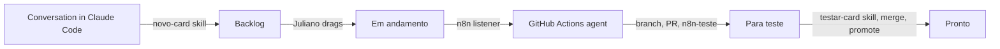

# Kanban: from a conversation to a pull request

How changes to Zacretário are made: a Trello board, a Claude agent on GitHub Actions, and a test copy of n8n. The full design is in [superpowers/specs/2026-11-28-kanban-trello-design.md](superpowers/specs/2026-11-28-kanban-trello-design.md).

## The board

| List | Who puts a card there | What happens |
|---|---|---|
| **Backlog** | Claude, at the end of a brainstorm in Claude Code | The card waits |
| **Em andamento** | Juliano | The agent picks it up and implements it |
| **Para teste** | The agent, when it is done | The card waits for testing, with no deadline |
| **Pronto** | Juliano, or Claude after his "ok" | Done |

Labels: **Bloqueado** (the agent stopped and says why in a comment) and **Na fila** (waiting for the slot).

**One card at a time.** There is one test n8n, so one card holds it from "Em andamento" until it leaves "Para teste". A card moved to "Em andamento" while the slot is taken gets **Na fila**, and starts by itself when the slot frees up (highest card in the list first).

## A card

- **Title** in the infinitive.
- **User story:** "As <person>, I want <thing>, so that <reason>."
- **Context, acceptance criteria, development guide** (workflows and files to touch, steps, pitfalls, how to test in n8n-teste) and **out of scope**.
- A checklist with the acceptance criteria: the agent ticks what it validated; the rest is ticked in the test.

## The pieces

- **Trello MCP:** [`atlassian-trello-mcp`](https://www.npmjs.com/package/atlassian-trello-mcp), pinned to `1.7.2`, with a Trello API key and token (Trello's official MCP only accepts interactive OAuth, which GitHub Actions cannot do).
- **n8n-teste:** a second n8n on the same server, with its own databases and credentials and the same workflow IDs as production, so a tested workflow imports into production unchanged. See [setup.md](setup.md#test-n8n-for-the-kanban-agent).
- **Listener:** the workflow *Kanban: card movido* in production n8n receives Trello's webhook, applies the one-card rule and calls GitHub's `repository_dispatch`.
- **Agent:** `.github/workflows/kanban-agente.yml` runs Claude Code on the card, works in n8n-teste, opens a pull request and never merges or touches production.
- **Promotion** is always Juliano's: he merges the pull request and imports the workflow into production, guided by the `testar-card` skill.
