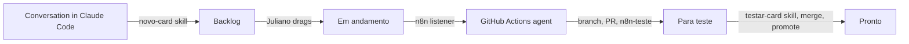

# Kanban: from a conversation to a pull request

How changes to Zacretário are made: a Trello board, a Claude agent on GitHub Actions, and a test copy of n8n. The full design is in [superpowers/specs/2026-11-28-kanban-trello-design.md](superpowers/specs/2026-11-28-kanban-trello-design.md).

## The board

| List | Who puts a card there | What happens |
|---|---|---|
| **Backlog** | Claude, at the end of a brainstorm in Claude Code | The card waits |
| **Em andamento** | Juliano | The agent picks it up and implements it |
| **Para teste** | The agent, when it is done | The card waits for testing, with no deadline |
| **Pronto** | Juliano, or Claude after his "ok" | Done |

Labels: **Bloqueado** (the agent stopped and says why in a comment) and **Na fila** (waiting for the slot).

**One card at a time.** There is one test n8n, so one card holds it from "Em andamento" until it leaves "Para teste". A card moved to "Em andamento" while the slot is taken gets **Na fila**, and starts by itself when the slot frees up (highest card in the list first).

## A card

- **Title** in the infinitive.
- **User story:** "As <person>, I want <thing>, so that <reason>."
- **Context, acceptance criteria, development guide** (workflows and files to touch, steps, pitfalls, how to test in n8n-teste) and **out of scope**.
- A checklist with the acceptance criteria: the agent ticks what it validated; the rest is ticked in the test.

## The pieces

- **Trello MCP:** [`atlassian-trello-mcp`](https://www.npmjs.com/package/atlassian-trello-mcp), pinned to `1.7.2`, with a Trello API key and token (Trello's official MCP only accepts interactive OAuth, which GitHub Actions cannot do).
- **n8n-teste:** a second n8n on the same server, with its own databases and credentials and the same workflow IDs as production, so a tested workflow imports into production unchanged. See [setup.md](setup.md#test-n8n-for-the-kanban-agent).
- **Listener:** the workflow *Kanban: card movido* in production n8n receives Trello's webhook, applies the one-card rule and calls GitHub's `repository_dispatch`.
- **Agent:** `.github/workflows/kanban-agente.yml` runs Claude Code on the card, works in n8n-teste, opens a pull request and never merges or touches production.
- **Promotion** is always Juliano's: he merges the pull request and imports the workflow into production, guided by the `testar-card` skill.

## The agent

`.github/workflows/kanban-agente.yml` runs only on the `repository_dispatch` event `card-em-andamento`; nothing a stranger can do (an issue, a comment, a pull request from a fork) starts it. Its instructions are in [.github/kanban-agente/prompt.md](../.github/kanban-agente/prompt.md) and its MCP servers (Trello and n8n-teste) in [mcp.json](../.github/kanban-agente/mcp.json), which reads the tokens from the repository secrets.

**What a run does.** It comments "Comecei" with the run link, reuses the card's branch `card/<number>-<slug>` or creates it from `main`, follows the card's development guide in n8n-teste, runs `node --test workflows/code/tests/`, opens or updates a pull request, ticks only the criteria it could check, comments the pull request link and a test script, and moves the card to **Para teste**. If anything fails, or the card asks for something the rules forbid, it comments why, adds **Bloqueado** and leaves the card in **Em andamento**. A green run on GitHub only means the agent finished; the board says whether the card is done.

**Layers of defence**, because the card text becomes instructions:

1. Only Juliano writes on the board, which is private.
2. The prompt treats the card as a spec, not an authority: no secrets, no production, no merge, no `.github/` changes, one command at a time.
3. `--allowedTools` limits the shell to `git`, `gh pr`, `gh api` and `node --test`, and each part of a chained command is checked on its own. This is not a sandbox (git options and test files can run code), so it is a layer, not the wall.
4. GitHub masks secrets as `***` in the public log, and `show_full_output` stays off, so tool results are not printed.
5. Merging is Juliano's, after reading the pull request.

The action is pinned by commit SHA (`claude-code-action` v1.0.290), `card_id` is validated (24 hex characters) and reaches the shell only through `env:`, and each run is limited to 60 minutes and 80 turns, one at a time (`concurrency`).

**Reading a run.** The last step, *Ferramentas negadas*, lists each tool the allowlist blocked, with only its command or file. A few denials are normal (the agent tries a shortcut such as `node -e` and falls back); the same denial on every run means the prompt or the allowlist needs a change.

**Checked on 28/11/2026:** a real card went from **Em andamento** to **Para teste** with its pull request in about 90 seconds; a card asking for `TRELLO_TOKEN` in the pull request was refused and blocked; a card whose test cannot pass was blocked and stayed in **Em andamento**. No secret appeared in any log.

**If no job starts** ("account is locked due to a billing issue"): GitHub had created $0 budgets with usage blocked on an account with no payment method, and they block even free public-repository minutes. They can be edited or deleted only after adding a payment method; with the card added and the budgets left blocked, the jobs ran and nothing paid can run.
